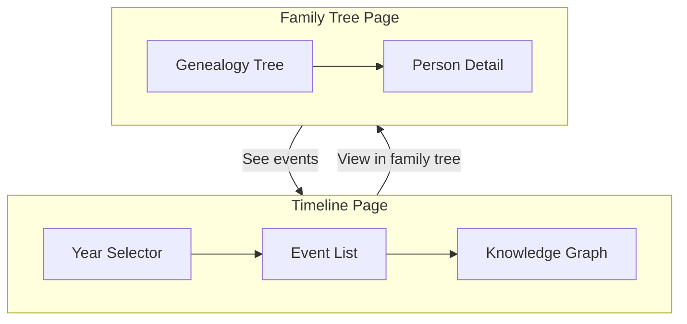
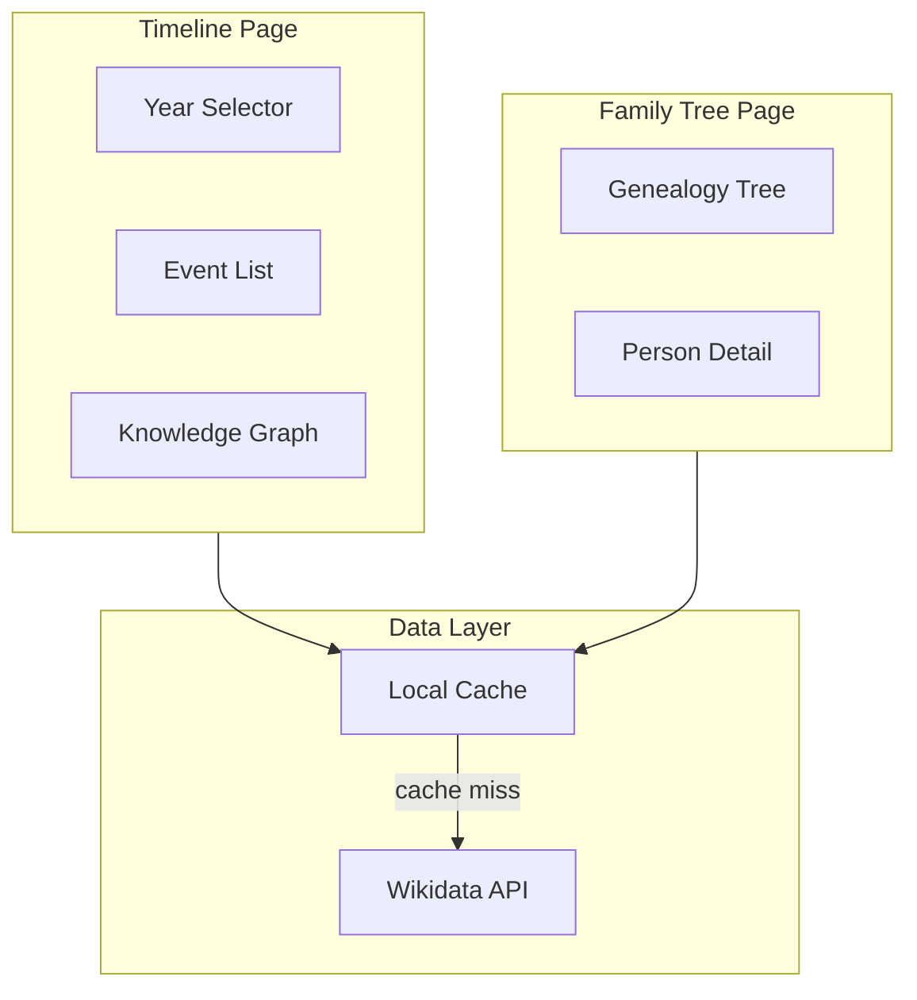
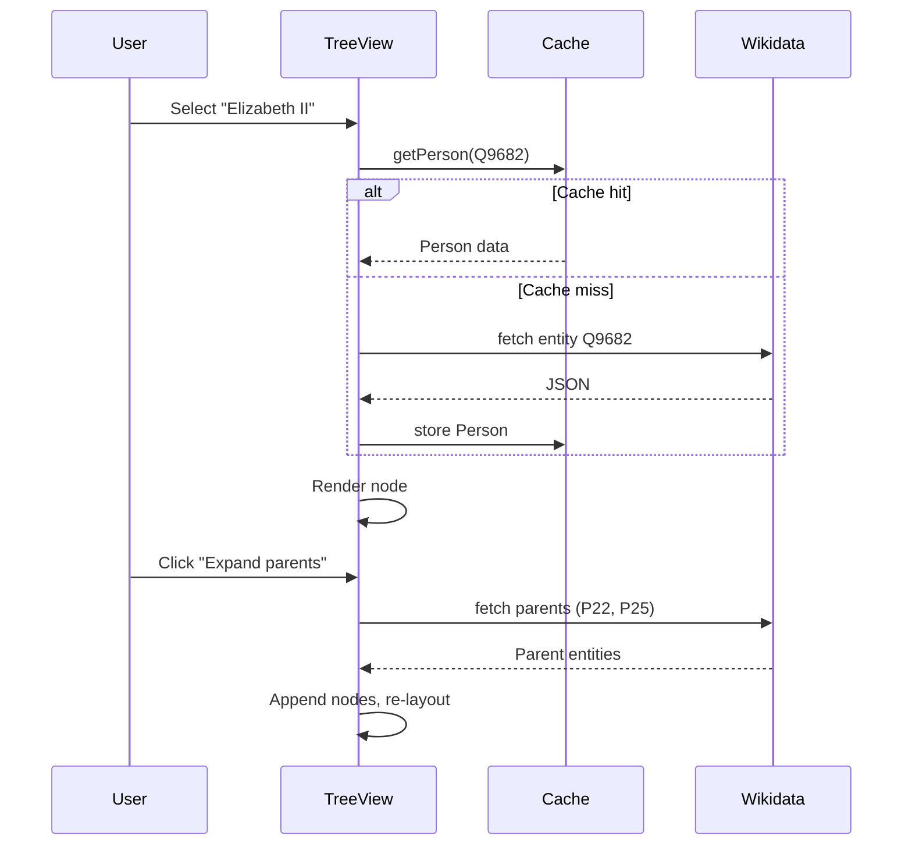

# History Map: Interactive History Platform

## Vision Summary

The site has **two distinct features**, each on its own page:


| Feature               | Page               | What it does                                                                                                                                 |
| --------------------- | ------------------ | -------------------------------------------------------------------------------------------------------------------------------------------- |
| **World Timeline**    | `/` or `/timeline` | Year selector → events for that year → click through events, people, places in a knowledge-graph style (related nodes, infinite exploration) |
| **Royal Family Tree** | `/family-tree`     | Dedicated genealogy view: modern monarchs back to Charlemagne, as wide as the data allows                                                    |


They are **separate pages**, not intertwined on the same screen. They **link to each other** when it makes sense—e.g., a royal person on the timeline can have a "View in family tree" link; a person on the tree can have "See events" linking to the timeline. But each feature is self-contained and has its own UI.

---

## Platform & UX

### Web-First, Mobile-Compatible

- **Primary target**: Desktop/web. Optimize for smooth, rich interactions on larger screens.
- **Mobile**: Responsive layout; works on phones and tablets. Some tradeoffs acceptable—e.g., graph may be simplified or use a list view on small screens; timeline might scroll differently. Goal: usable and readable, not pixel-perfect parity.

### Fluid Animations: Animated Storybook Feel

The site should feel like **turning pages in an animated storybook**—history unfolding as you explore.

- **Page transitions** - Smooth fade/slide between Timeline, Family Tree, Map (not jarring full reloads)
- **Graph/tree interactions** - Nodes animate in when loaded; edges draw or fade; clicking a node gently recenters with a smooth pan
- **Detail panels** - Slide or fade in from the side; content appears with staggered reveals
- **Timeline scrubbing** - Year selector has a fluid feel; event cards animate in as the year changes
- **Map** - Markers appear with subtle pop; pan/zoom feels natural

**Tech**: CSS transitions, Framer Motion (or similar), or GSAP for orchestrated sequences. Avoid abrupt jumps—every state change should feel intentional and cinematic.

---

## Additional Features (Path, Map, On This Day)

### Path Between Two Nodes

"How are Charlemagne and Napoleon connected?"—find and visualize the path through the graph (or family tree).

- **Where**: Timeline page (graph) and/or Family Tree page. Search or pick two nodes; graph highlights the path between them.
- **Interaction**: User selects A and B (e.g., via search or clicking); path animates into view—edges highlight, nodes along the path emphasize. Could show step-by-step ("Charlemagne → Louis the Pious → ... → Napoleon").
- **Data**: Graph traversal (BFS/shortest path) on existing edges. No new data source.

### Map View

"Where did things happen in 1776?"—events for a year (or selected nodes) plotted on a world map.

- **Where**: New page at `/map` or a toggle/view on the Timeline page. When viewing a year's events, "Show on map" plots them.
- **Data**: Wikidata P276 (location), P625 (coordinates). Events and places already have location data.
- **Interaction**: Map pans/zooms; markers appear with animation. Click marker → event/person/place detail. Integrates with timeline year selector.

### On This Day

Events that happened on today's date in history. Drives repeat visits and sharing.

- **Where**: Timeline page—prominent "On this day" section when landing, or a dedicated `/on-this-day` route.
- **Data**: SPARQL: events where P585 (date) matches today's month and day, any year. Filter to notable events.
- **Interaction**: Card carousel or list; click to explore in graph. Refreshes daily (or by date picker for "on this day in 1776").

---

## Data Reality Check

**Wikidata** has extensive royal genealogy. Key findings:

- **Depth**: Proven lineage back to Charlemagne (Q3044, crowned 800 AD). The [wikidata-family-tree](https://github.com/jdan/wikidata-family-tree) project traces Tom Hanks ancestry 79 generations back to Ostrogothic kings (~500 AD).
- **Breadth**: European royal houses (English, Scottish, French, Spanish, German, Byzantine, etc.) are well-documented. [WikiProject Genealogy royal gateway](https://www.wikidata.org/wiki/Wikidata:WikiProject_Genealogy/royal_gateway) tracks English/Scottish descendants.
- **Properties**: P22 (father), P25 (mother), P40 (child), P39 (position held) for monarch titles.
- **API**: Free, no auth for reads. SPARQL at `query.wikidata.org` or REST API for entity lookups.

**Scope recommendation**: Start with European royal houses (British, French, Spanish, Holy Roman) from ~1500 to present, with Charlemagne as the ancestral root. Expand to Byzantine, Scandinavian, and earlier dynasties in later iterations.

---

## Extensibility: Easy to Add On

The project should be **trivial to extend**—no major refactors when adding more data. Treat everything as a graph: nodes and edges. Adding more is just adding more nodes.

### Configurable Scope (Time Range)

- **v1**: Timeline covers 1500 AD to today. Year selector, events, graph—all work within this range.
- **Later**: Change a config value (e.g., `TIMELINE_START_YEAR = 500`) and expand backwards. No code changes to the graph or UI—just more data from Wikidata.
- **Config location**: Single source of truth (e.g., `config.ts` or env) for `minYear`, `maxYear`. The timeline and SPARQL queries use these. Expanding = update the config.

### Graph = Add Nodes Trivially

- **Node types** (event, person, place) share a common `GraphNode` shape. Adding a new type (e.g., "artifact", "document") = add a new type to the union + a renderer. No schema migration.
- **Edges** are generic: `{ sourceId, targetId, relationType }`. New relation types (e.g., "influenced by") = just use them in the data. The graph doesn't care.
- **Data source**: Wikidata returns whatever exists. No hardcoded event lists. Expanding the time range or adding regions = broader SPARQL queries, not new code paths.

### New Features as New Pages

- Timeline and Family Tree are separate pages. Adding a third feature (e.g., "Wars", "Inventions") = new route, new page, same data layer. The graph model and cache are shared.

### Summary


| What to add                          | Effort                                 |
| ------------------------------------ | -------------------------------------- |
| Extend timeline 1500 → 1000 → 500 BC | Config change + broader SPARQL         |
| Add new node type (e.g., "artifact") | New type + detail panel renderer       |
| Add new relation type                | Use it in data; graph renders it       |
| Add new page/feature                 | New route + components; reuse services |


---

## Timeline Page: Events, Places, and People (Knowledge Graph)

This is the **Timeline page**—the "click through history" experience. Users pick a year, see what happened, then click into events, people, and places and follow connections. All of this lives on one page (year selector, event list, and graph view).

### Timeline View

- **Year selector**: Scrollable timeline with configurable range. **v1**: 1500 AD to today. Later: expand backwards (1000, 500, etc.) via config—no UI changes.
- **Year summary**: When a year is selected, fetch and display a curated list of events:
  - Wars, treaties, discoveries, births/deaths of notable figures, cultural milestones
  - Grouped by category (Politics, Science, Culture, etc.) or by region
- **Event cards**: Each event is clickable and opens the graph view centered on that event

### Knowledge Graph (Click-Through Navigation)

- **Node types**:
  - **Events** (e.g., "French Revolution", "Moon Landing") - have date, description, participants, location
  - **People** - birth/death, roles, events they participated in
  - **Places/Countries** - events that happened there, people born/died there
- **Edges**: "participated in", "occurred in", "related to", "caused", "part of"
- **Interaction**: Click a node to see its detail panel; related nodes appear as links. Click a link to "travel" to that node—the graph recenters, new connections load. Infinite exploration.

### Wikidata Model for Events


| Entity | Wikidata type         | Key properties                                                               |
| ------ | --------------------- | ---------------------------------------------------------------------------- |
| Event  | Q1190554 (occurrence) | P585 (point in time), P276 (location), P828 (has cause), P921 (main subject) |
| Person | Q5 (human)            | P569 (birth), P570 (death), P27 (country), P39 (position held)               |
| Place  | Q56061 (place)        | P131 (located in), P625 (coordinates), P17 (country)                         |


SPARQL can query "events in year X" or "events at place Y" or "people who participated in event Z". The graph is built by following these relationships.

### How the Two Features Connect




- **Timeline page**: User picks a year → sees events → clicks event/person/place → explores in graph. If viewing a royal person, a link takes them to the **Family Tree page** for that person.
- **Family Tree page**: User browses genealogy. If they want historical context, a link takes them to the **Timeline page** (e.g., pre-filled with that person's birth year or "events they participated in").

---

## Family Tree Page

A **separate page** at `/family-tree`. Dedicated genealogy view with no timeline or event list.

- **Tree visualization** - Ancestors (toward Charlemagne) and descendants; lazy-loaded generations
- **Person detail panel** - Name, dates, titles, description, image, Wikipedia link
- **Jump-to presets** - Charlemagne, Elizabeth II, Louis XIV, etc.
- **Cross-link** - "See events" on a person → navigates to Timeline page

---

## Technical Architecture




**Tech stack**:

- **React + Vite** - Fast dev, simple deployment
- **TypeScript** - Type safety for Wikidata entities
- **Wikidata API** - Primary data source (no backend initially)
- **IndexedDB / localStorage** - Client-side cache for fetched nodes
- **D3 or custom SVG** - Tree layout; react-force-graph or similar for knowledge graph
- **Framer Motion** (or GSAP) - Fluid animations, page transitions, animated storybook feel
- **Map library** (Phase 5) - Leaflet, Mapbox, or similar for Map view (Wikidata has P625 coordinates)

**Why no backend initially**: Wikidata is public and CORS-friendly. You can fetch directly from the client. A backend becomes useful later for pre-computing large subgraphs, rate limiting, or combining with other APIs.

---

## Backend Caching (Future Phase)

Goal: Stop constantly pinging Wikidata. Cache entities and query results server-side. **Serverless, hosted** options below.

### Cache Strategy

- **Entity cache**: Store fetched Wikidata entities (person, event, place) by Q-id. TTL (e.g., 7–30 days)—Wikidata changes slowly.
- **Query cache**: Store "events for year X", "on this day", etc. TTL 24h–7d. Invalidate when refreshing.
- **Flow**: Client → your API → check cache → if miss, fetch Wikidata → store in cache → return. Cache-aside pattern.

### Option A: Upstash Redis + Vercel/Netlify Functions (Chosen)


| Aspect      | Details                                                                                                 |
| ----------- | ------------------------------------------------------------------------------------------------------- |
| **What**    | Serverless Redis. Key = `entity:Q9682` or `events:1776`. Value = JSON. TTL per key.                     |
| **API**     | Thin serverless function (Vercel/Netlify): `GET /api/entity/:id`, `GET /api/events/:year`. Cache-aside. |
| **Images**  | Direct Wikidata/Commons URLs—no CDN. Link to source.                                                    |
| **Pros**    | Minimal setup, pay-per-request, no schema. Good for entity-by-ID and simple query keys.                 |
| **Cons**    | No SQL/GraphQL—just key-value. 256MB free tier; text-only, evict/TTL as needed.                         |
| **Adapter** | Implement `CacheAdapter` interface; swap to Supabase/PlanetScale later without changing API.            |


### Option B: Supabase (PostgreSQL)


| Aspect       | Details                                                                                                                           |
| ------------ | --------------------------------------------------------------------------------------------------------------------------------- |
| **What**     | Hosted Postgres. Tables: `entities(id, type, data JSONB, fetched_at)`, `events_by_year(year, event_ids JSONB)` or junction table. |
| **API**      | Supabase REST (auto-generated) or custom Edge Functions. SQL queries.                                                             |
| **Pros**     | SQL, full querying, free tier. Can cache arbitrary queries. Add PostGraphile for GraphQL if desired.                              |
| **Cons**     | Schema + migrations. Slightly more ops than pure Redis.                                                                           |
| **Best for** | Flexible caching, precomputed queries, future analytics.                                                                          |


### Option C: PlanetScale (MySQL)


| Aspect       | Details                                                                      |
| ------------ | ---------------------------------------------------------------------------- |
| **What**     | Serverless MySQL. Same idea as Supabase—tables for entities, events_by_year. |
| **API**      | Custom API (Vercel/Netlify) or Prisma/Drizzle. SQL.                          |
| **Pros**     | SQL, branching for dev, serverless. Familiar if you like MySQL.              |
| **Cons**     | No built-in REST/GraphQL—you build the API layer.                            |
| **Best for** | SQL comfort, MySQL preference.                                               |


### Option D: Hasura + Supabase/Postgres (GraphQL)


| Aspect       | Details                                                                                              |
| ------------ | ---------------------------------------------------------------------------------------------------- |
| **What**     | Postgres for storage. Hasura auto-generates GraphQL API from schema.                                 |
| **API**      | GraphQL. Frontend queries `{ entity(id: "Q9682") { ... } }`, `{ eventsByYear(year: 1776) { ... } }`. |
| **Pros**     | GraphQL fits graph-shaped data. Type-safe. Single endpoint. Real-time subscriptions if needed.       |
| **Cons**     | Extra service (Hasura Cloud or self-hosted). Learning curve if new to Hasura.                        |
| **Best for** | GraphQL preference; clean API that mirrors your node/edge model.                                     |


### Option E: Firebase Firestore (NoSQL)


| Aspect       | Details                                                                                           |
| ------------ | ------------------------------------------------------------------------------------------------- |
| **What**     | NoSQL document store. Collections: `entities`, `eventsByYear`. Doc ID = entity ID or `year_1776`. |
| **API**      | Firestore SDK or REST. Client or server.                                                          |
| **Pros**     | NoSQL, serverless, generous free tier. Simple document model.                                     |
| **Cons**     | Querying "events in region X" needs composite indexes or denormalization.                         |
| **Best for** | NoSQL comfort, document-oriented caching.                                                         |


### Recommendation


| Priority | Option                     | Why                                                                                                                  |
| -------- | -------------------------- | -------------------------------------------------------------------------------------------------------------------- |
| **1st**  | **Upstash Redis + Vercel** | Fastest to add. Entity cache + `events:{year}`, `onThisDay:{mm-dd}` keys. Minimal code. Serverless.                  |
| **2nd**  | **Supabase**               | If you want SQL and richer queries (filter by region, precompute paths). Good balance of flexibility and simplicity. |
| **3rd**  | **Hasura + Supabase**      | If you want GraphQL and a schema that matches your graph model. More setup, cleaner API long-term.                   |


### Migration Path

1. **Phase 1–4**: Client-only, IndexedDB cache. No backend.
2. **When ready**: Add Vercel/Netlify API routes. Implement cache-aside with chosen backend (Redis or Supabase).
3. **Frontend change**: Swap `fetch(wikidataUrl)` for `fetch(/api/entity/Q9682)`. API handles cache + Wikidata fallback.
4. **Optional**: Background job (e.g., Vercel Cron) to pre-warm cache for popular years or "on this day" daily.

### Chosen: Upstash Redis + Adapter Layer

**Start with Upstash Redis**—see how it works, iterate from there. Use direct image URLs from Wikidata/Commons (link to source); no CDN needed.

**Adapter layer**: Abstract the cache behind an interface so you can swap providers without changing app logic.

```ts
// Cache adapter interface - implement for each provider
interface CacheAdapter {
  get<T>(key: string): Promise<T | null>;
  set(key: string, value: unknown, ttlSeconds?: number): Promise<void>;
  delete(key: string): Promise<void>;
}

// Implementations
class UpstashCacheAdapter implements CacheAdapter { ... }
class SupabaseCacheAdapter implements CacheAdapter { ... }  // future
class InMemoryCacheAdapter implements CacheAdapter { ... }  // dev/testing
```

- **API layer** uses `CacheAdapter` only—never talks to Upstash directly.
- **Config**: `CACHE_PROVIDER=upstash` (or `supabase`, `memory`). Factory returns the right adapter.
- **Switching**: Add new adapter, flip config, deploy. No changes to API routes or frontend.

---

## Implementation Plan (Phased Rollout)

### Phase 1: Family Tree Page (First Feature)

*Dedicated page at `/family-tree`. Establishes project structure and Wikidata integration.*

1. **Project setup** - Vite + React + TypeScript, routing (home, family tree)
2. **Wikidata integration** - `fetchPerson(qId)`, SPARQL for parent/child, `Person` model
3. **Tree visualization** - Seed from Elizabeth II or Charles III; ancestors toward Charlemagne, descendants down; lazy load 2-3 generations at a time
4. **Person detail panel** - Name, dates, titles, description, image, Wikipedia link
5. **Navigation** - Jump-to presets, zoom/pan

### Phase 2: Timeline + Year Summary

*Adds the temporal entry point and event summaries.*

1. **Timeline component** - Scrollable year selector; range from config (v1: 1500–today; expand later by changing config)
2. **Year summary API** - SPARQL: "events where P585 (date) falls in year X", limit to notable events
3. **Event list/cards** - Display events for selected year, grouped by category or region
4. **Event detail** - Click event to see description, date, location, participants (links to people/places)

### Phase 3: Knowledge Graph (on Timeline Page)

*The click-through exploration lives on the Timeline page—it's part of that feature, not a third page.*

1. **Graph model** - `GraphNode` type for events, people, places; edges for relations
2. **Graph visualization** - Force-directed layout; appears when user clicks "Explore" on an event (or as a sub-view)
3. **Detail panel** - Renders event/person/place; shows related entities as clickable links
4. **Click-through** - Click related entity → fetch + add to graph, recenter
5. **Cross-link to tree** - When viewing a royal person in the graph, show "View in family tree" → navigates to `/family-tree?person=Q123`

### Phase 4: Polish and Cross-Linking

1. **Royal tree polish** - Multiple houses, spouse links, virtualization
2. **Timeline/graph polish** - Search bar, filters
3. **Cross-linking** - Tree page: "See events" on a person → navigates to Timeline page (with that person or their era). Timeline page: "View in family tree" on royal person → navigates to Tree page
4. **Fluid animations** - Page transitions, graph/tree node animations, detail panel reveals. Establish the animated storybook feel.

### Phase 5: Path, Map, On This Day

1. **Path between nodes** - "Find path" UI on Timeline (graph) and Family Tree. Select two nodes; highlight path with animation. Works with existing graph traversal.
2. **Map view** - New `/map` page or Timeline toggle. Plot events for selected year on world map; markers with coordinates from Wikidata. Click marker → detail.
3. **On this day** - "On this day" section on Timeline landing (or `/on-this-day`). SPARQL for events matching today's month/day. Card list; click to explore in graph.

---

## Routing and Page Structure


| Route              | Page                 | Contents                                                                                |
| ------------------ | -------------------- | --------------------------------------------------------------------------------------- |
| `/` or `/timeline` | **Timeline Page**    | Year selector, event list, "On this day", knowledge graph, path-between (when in graph) |
| `/family-tree`     | **Family Tree Page** | Genealogy tree, person detail, path-between                                             |
| `/map`             | **Map Page**         | World map with events for selected year; click marker for detail                        |


Global nav: links to all pages. Responsive; web-first, mobile-compatible with tradeoffs.

---

## Key Files and Structure

```
history-map/
├── api/                             # Backend phase: Vercel serverless routes
│   ├── entity/[id].ts
│   ├── events/[year].ts
│   └── lib/
│       ├── cache-adapter.ts         # CacheAdapter interface
│       ├── upstash-adapter.ts       # Upstash Redis impl
│       └── cache-factory.ts         # Returns adapter by CACHE_PROVIDER env
├── src/
│   ├── pages/
│   │   ├── TimelinePage.tsx         # Timeline page (year + events + graph + on-this-day)
│   │   ├── FamilyTreePage.tsx      # Family tree page
│   │   └── MapPage.tsx             # Map view (Phase 5)
│   ├── components/
│   │   ├── FamilyTree/             # Used by FamilyTreePage
│   │   │   ├── FamilyTree.tsx
│   │   │   ├── TreeNode.tsx
│   │   │   ├── TreeLayout.ts
│   │   │   └── useTreeData.ts
│   │   ├── Timeline/               # Used by TimelinePage
│   │   │   ├── Timeline.tsx        # Year selector + event list
│   │   │   ├── YearSummary.tsx
│   │   │   ├── EventCard.tsx
│   │   │   ├── OnThisDay.tsx       # "On this day" section (Phase 5)
│   │   │   └── KnowledgeGraph/     # Graph + path-between (Phase 5)
│   │   │       ├── GraphView.tsx
│   │   │       ├── GraphNode.tsx
│   │   │       └── useGraphData.ts
│   │   ├── Map/                    # Map view (Phase 5)
│   │   │   ├── MapView.tsx
│   │   │   └── EventMarker.tsx
│   │   └── EntityDetail/
│   │       └── EntityDetailPanel.tsx
│   ├── services/
│   │   ├── wikidata.ts
│   │   └── cache.ts                 # Client: IndexedDB (Phase 1–4)
│   ├── types/
│   │   ├── person.ts
│   │   ├── event.ts
│   │   └── graph.ts
│   ├── config.ts                 # minYear, maxYear, etc.—single source for scope
│   ├── App.tsx
│   └── main.tsx
├── package.json
└── README.md
```

---

## Data Flow: Loading the Tree




---

## Challenges and Mitigations


| Challenge                                          | Mitigation                                                                          |
| -------------------------------------------------- | ----------------------------------------------------------------------------------- |
| Wikidata data is messy (duplicates, missing dates) | Normalize on fetch; show "?" for unknown dates; link to Wikidata for verification   |
| Royal tree can be huge (1000s of nodes)            | Lazy load; virtualize; "focus" mode (show only path from A to B)                    |
| Complex marriages (divorces, multiple spouses)     | Start with primary parent-child; add spouse view in Phase 4                         |
| SPARQL learning curve                              | Use Wikidata Query Helper; start with simple parent/child and event-by-year queries |
| Events in Wikidata are sparse for some years       | Prioritize well-documented periods; show "No notable events" for empty years        |
| Graph can become cluttered with many nodes         | Limit visible edges per node; "expand" to load more; zoom/filter by type            |
| Mobile: complex graph/tree interactions            | Responsive layout; consider simplified list view for graph on small screens         |
| Animations on low-end devices                      | Prefer CSS transitions; reduce or disable heavy JS animations on slow devices       |


---

## Optional Enhancements (Post-MVP)

- **Country/region filter** - "Events in Europe 1700-1800" or "Show only French royalty"
- **Wikipedia summary** - Fetch short descriptions from Wikipedia API for richer event/person blurbs
- **Backend pre-computation** - Pre-build popular subgraphs (e.g., "1776 events") for faster load

---

## Recommended First Steps

**Phase 1 (Family Tree page)** – Start here:

1. Create Vite + React + TS project with routing (e.g., React Router)
2. Add `/family-tree` route and nav link to it
3. Implement `wikidata.ts` with `fetchPerson(qId: string)`
4. Build the tree: 3 generations, click-to-expand, person detail panel, caching
5. Add "Jump to Charlemagne" and trace path from a modern monarch

**Phase 2 (Timeline page)** – Separate page:
6. Add `/` or `/timeline` route with year selector and event list
7. Add `fetchEventsForYear(year: number)` via SPARQL
8. Build event cards and event detail

**Phase 3 (Graph on Timeline page)** – Add click-through to Timeline:
9. Add `GraphView` to the Timeline page (e.g., when user clicks "Explore" on an event)
10. Implement click-through; add "View in family tree" link for royal persons → navigates to `/family-tree?person=Q123`

**Phase 4 (Cross-links + animations)** – Connect the two pages and add fluid animations:
11. On Family Tree page: "See events" on a person → navigates to Timeline page with that person or year
12. Add Framer Motion (or GSAP); implement page transitions, graph/tree node animations, detail panel reveals. Aim for animated storybook feel.

**Phase 5 (Path, Map, On this day)** – Additional features:
13. Path between nodes on graph and family tree
14. Map page with events plotted by coordinates
15. "On this day" section on Timeline landing

Web-first; ensure responsive layout for mobile compatibility (with acceptable tradeoffs).